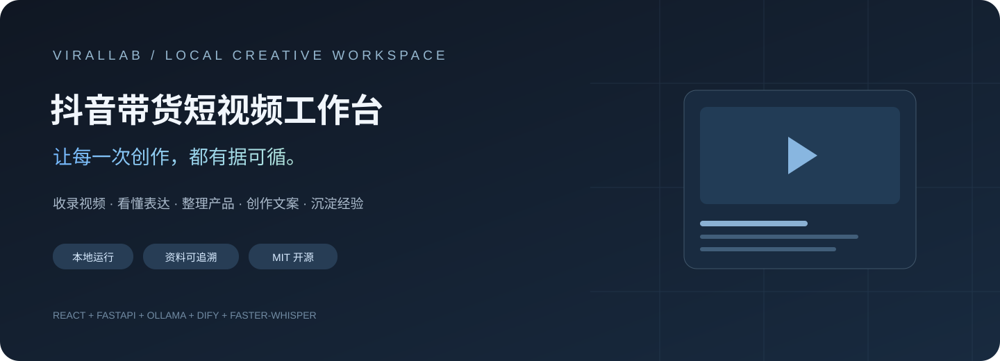
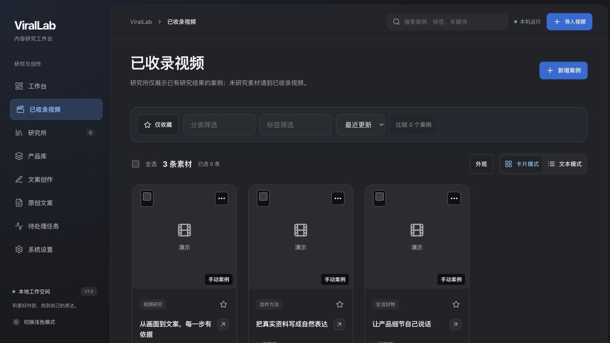
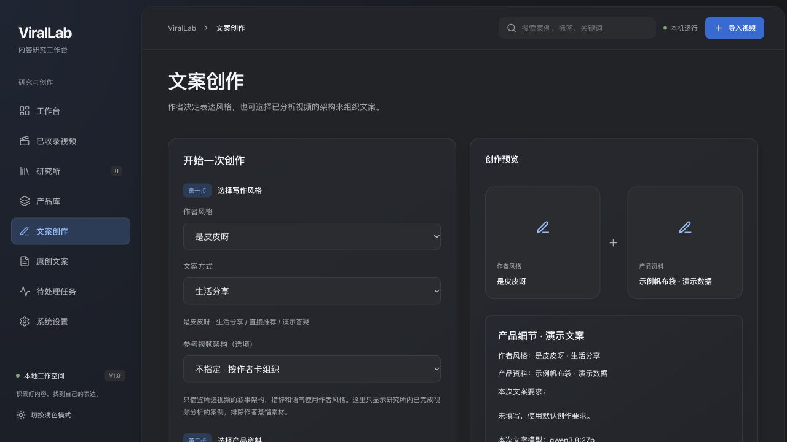

<div align="center">



# 抖音带货短视频工作台

**从一条值得研究的视频，到一份属于自己的产品文案。**

本地视频研究与创作工作空间 · ViralLab

[](https://github.com/Nayint/douyin-video-workbench/actions/workflows/install-smoke.yml)
[](LICENSE)
[](docs/SETUP.md)
[](frontend/package.json)
[](docs/SETUP.md)

[快速开始](#快速开始) · [完整环境配置](docs/SETUP.md) · [实际版本清单](config/reference-environment.json) · [验收记录](docs/OPEN_SOURCE.md)

</div>

---

## 把研究与创作放进同一个工作空间

ViralLab 面向需要持续研究短视频、管理产品事实、撰写带货口播的创作者。视频、逐字稿、研究结果、产品资料和文案版本彼此关联，方便回看每次判断与修改的依据。

| 收录内容 | 研究表达 | 组织事实 | 创作文案 | 积累经验 |
| :-- | :-- | :-- | :-- | :-- |
| 本地视频、平台链接、手动案例 | 关键帧、逐字稿、文案结构、标题与封面 | 产品正文、文档、图片与待确认信息 | 作者规则或参考架构、事实核对、版本与导出 | 逐句反馈、修订记录、收藏与写作沉淀 |



<sub>截图来自实际运行的公开版本，内容由演示脚本生成，不是作者的私人案例库。</sub>

## 让表达有风格，也有事实边界

- **作者风格与视频架构分开选择**：可用作者规则组织表达，也可借鉴已研究视频的叙事结构。
- **产品事实先行**：规格、价格、真实体验和未知信息进入本次创作资料；生成后逐句核对，无依据内容可能触发修订或拒绝保存。
- **模型选择可核对**：文字与视觉模型分别配置；Dify 采用独立运行版本，保留源工作流。
- **每一步可回看**：任务进度、版本、转写、研究结果与导出在本地保存。
- **人工保持决定权**：AI 结果需要复核，不以公开互动指标保证转化或“爆款”。



## 快速开始

已安装 Python 3.11、Node.js 20.19+、FFmpeg 和 Poppler（扫描 PDF）后：

```bash
git clone https://github.com/Nayint/douyin-video-workbench.git
cd douyin-video-workbench
bash scripts/bootstrap.sh
.venv/bin/python -m uvicorn backend.app:app --host 127.0.0.1 --port 8765
```

打开 **http://127.0.0.1:8765** 。初次启动为空数据库，基础管理功能可用；AI 功能需要下面的组件。

| 想使用的能力 | 配置入口 |
| :-- | :-- |
| 同作者模型与语音转写 | [Ollama 与 faster-whisper](docs/SETUP.md#3-ollama-与相同模型) |
| 同一作者写作规则 | [安装作者卡](docs/SETUP.md#5-安装同一作者写作规则) |
| Dify 参考案例创作 | [导入实际工作流并绑定自己的密钥](docs/SETUP.md#6-dify-1171) |
| 平台链接获取及原配套服务 | [BiliNote 与桥接服务](docs/SETUP.md#7-bilinote-与旧链接工作流) |
| 原首页三维设备展示 | [第三方资产配置](docs/SETUP.md#8-恢复原有首页设备展示可选) |

**希望接近作者当前使用环境，请完整阅读 [SETUP.md](docs/SETUP.md)**。仅安装本仓库，不等于安装了模型、Dify、平台获取服务和个人资料库。

## 实际参考环境

```text
浏览器 / React 19
       │
FastAPI · 本地任务队列 · SQLite · 笔记目录
       ├── FFmpeg → 关键帧 / 音轨 → faster-whisper small
       ├── Ollama → qwen3.8:27b + qwen3-vl:8b-instruct
       ├── 作者规则 → 生成 / 产品事实核对 / 版本记录
       ├── Dify 1.17.1 → 实际原型 DSL / 独立模型运行版本
       └── BiliNote 2.4.5 → 可选平台获取服务
```

本仓库保留视频工作台的实际业务代码，并补入原来位于项目外的工作流、产品正文复用模块、配套桥接代码和运行作者规则。模型 digest、Dify 源码 commit、插件版本与镜像 digest 见 [机器可读参考清单](config/reference-environment.json)。

同版本与同流程可以复现；生成文本仍受模型、硬件、采样和输入资料影响，不能承诺逐字相同。私人视频、产品资料、分析历史、学习反馈与凭据均不公开。第三方设备模型需合法自行准备，庄园和游戏不在本仓库发布范围。

## 验证与目录

```bash
.venv/bin/python scripts/check_environment.py
.venv/bin/python scripts/configure_local.py --install-author --check
.venv/bin/python scripts/verify_reference.py
.venv/bin/python -m pytest -q tests/test_first_install.py
```

```text
backend/                 视频研究、产品、创作与任务后端
frontend/                React 界面及必要公共素材
config/                  参考环境清单、实际作者规则
scripts/                 安装、配置、诊断与虚构演示数据
deploy/dify/            无密钥工作流、正文复用与可选桥接
docs/                   完整配置、验收记录和实际界面截图
```

当前 macOS ARM64 独立安装与基础流程已验证。本机真实模型的作者生成、事实核对及 small 转写已运行；这不等于所有硬件和 Dify/平台路径均已验收。完整测试存在已记录的既有失败，详见[验收记录](docs/OPEN_SOURCE.md)。

## 许可与来源

项目原创代码采用 [MIT](LICENSE)，Copyright © 2026 许咏琪。Third-party 代码、模型和素材遵循各自许可证；Dify 服务采用其独立许可，不能视为本仓库 MIT 的一部分。

感谢 [Ollama](https://github.com/ollama/ollama)、[Dify](https://github.com/langgenius/dify)、[faster-whisper](https://github.com/SYSTRAN/faster-whisper)、[BiliNote](https://github.com/JefferyHcool/BiliNote) 和 [Three.js](https://github.com/mrdoob/three.js)。第三方说明见 [DEPENDENCIES.md](docs/DEPENDENCIES.md) 与随附许可文件。
